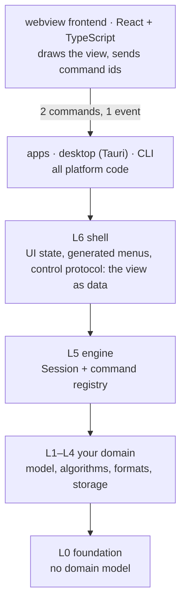
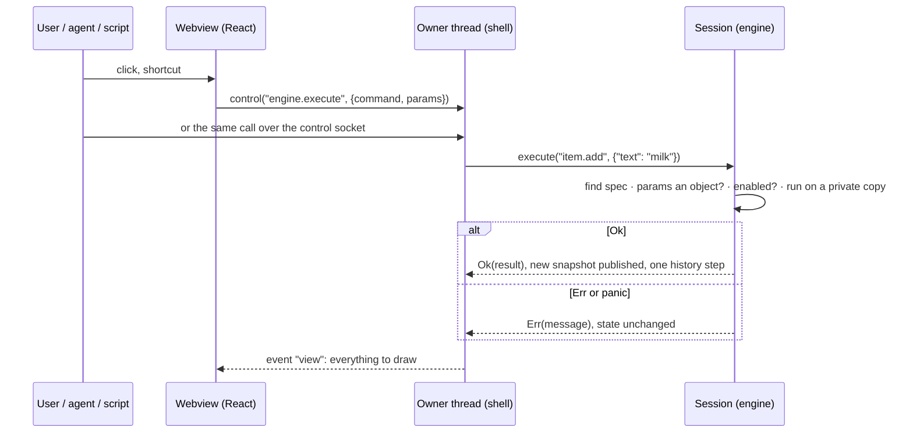

# av-rust-desktop-app-builder

A set of [Agent Skills](https://agentskills.io) for building native desktop applications in Rust
with [Tauri 2](https://tauri.app) and a React + TypeScript webview frontend, on an architecture
built to stay reliable and agent-drivable as the app grows:

- a **headless engine** in which every user action is a command with a stable id and JSON params,
- **immutable snapshots** of a serde data model, so a failed command changes nothing and undo swaps
  pointers,
- a **shell with no UI toolkit in it** that turns the engine's state into one value to draw,
- a **thin webview frontend** that draws that value and sends command ids back,
- **crates in enforced layers**, and one gate, `cargo xtask ci`, that checks all of it.

The skills carry a complete, buildable project template and the scripts to install the toolchain
and scaffold a project from it. Nothing in the stack or the architecture is specific to one kind
of app: editors, tools, viewers and clients for a service all fit.



## Install

```bash
npx skills add avatsaev/av-rust-desktop-app-builder-skill
```

This uses the official [`skills`](https://www.npmjs.com/package/skills) CLI, which auto-detects
your coding agent (Claude Code, Cursor, Codex, Gemini CLI and others) and installs the skills into
its skills directory.

```bash
# Install globally, available across all projects
npx skills add avatsaev/av-rust-desktop-app-builder-skill -g

# Install to a specific agent
npx skills add avatsaev/av-rust-desktop-app-builder-skill -a claude-code

# Install only some of the skills
npx skills add avatsaev/av-rust-desktop-app-builder-skill --skill av-rust-desktop-bootstrap
```

The skills are also published to the npm registry as
[`av-rust-desktop-app-builder`](https://www.npmjs.com/package/av-rust-desktop-app-builder) for
registry-based tooling such as [`skillpm`](https://skillpm.dev):

```bash
npx skillpm install av-rust-desktop-app-builder
```

## The skills

Six skills, each a thin index over its own reference files. They refer to each other by name and
install independently.

| Skill | Use it to | Carries |
|---|---|---|
| [`av-rust-desktop-architecture`](skills/av-rust-desktop-architecture/SKILL.md) | Decide whether the stack fits; place code in a layer; judge a change against the rules | The stack, the nine rules and what enforces each, layers, the five seams, the webview boundary, threads |
| [`av-rust-desktop-bootstrap`](skills/av-rust-desktop-bootstrap/SKILL.md) | Set up a machine and start a project | `setup.sh`, `new-project.sh`, the project template, first-run guide, troubleshooting, Day-0 checklist |
| [`av-rust-desktop-design`](skills/av-rust-desktop-design/SKILL.md) | Fit your kind of app into the architecture and replace the sample domain | App kinds, the decisions to make early, the ordered replacement steps |
| [`av-rust-desktop-develop`](skills/av-rust-desktop-develop/SKILL.md) | Do everyday work | Recipes: add a command, query, crate, component, control method or Tauri plug-in; change the file format; fix a bug; verify the UI from a rendered image |
| [`av-rust-desktop-grow`](skills/av-rust-desktop-grow/SKILL.md) | Add the next structural piece when its trigger comes true | Twenty patterns: several documents, background jobs, large data, a canvas view, dialogs, preferences, autosave, formats, MCP, plug-ins, translations, desktop integration, web content windows, a browser build and more |
| [`av-rust-desktop-ship`](skills/av-rust-desktop-ship/SKILL.md) | Get to a release | Build profiles, the gate, CI, the Tauri bundler, repository files, the pre-release checklist |

## Start a project

Once installed, ask your agent to create a Rust desktop app and it will load
`av-rust-desktop-bootstrap`. By hand, from that skill's directory:

```bash
bash scripts/setup.sh --check        # what is installed, what is missing; installs nothing
bash scripts/setup.sh --yes          # install it: system packages, Rust, Node.js, cargo-nextest
bash scripts/new-project.sh ../notepad --name notepad --title NotePad --id org.example.notepad
cd ../notepad
cargo xtask ci                       # the gate: all eight steps should pass before your first change
cargo run -p notepad                 # the window
```

`setup.sh` supports Linux (apt, dnf, pacman) and macOS, and Git Bash or WSL on Windows for
everything it can reach from a shell. It installs nothing without `--yes` or an interactive
confirmation.

`new-project.sh` writes 99 files: a Cargo workspace (`doc`, `ops`, `format`, `engine`, `shell`,
`testkit`, `xtask`), the Tauri desktop app with its React frontend, a headless CLI, a CI workflow,
and the documents a repository needs (`README.md`, `AGENTS.md`, `docs/`, licences,
`ATTRIBUTION.md`, `SECURITY.md`). The sample domain is a checklist with undo, a file format, menus
and shortcuts; the `av-rust-desktop-design` skill replaces it with yours.

## What the generated project gives you



- **Every action is a command.** The window, keyboard shortcuts, the CLI, the control channel and
  tests all dispatch the same ids. Menus and shortcut tables are generated from the registry.
- **What a person sees is what an agent reads.** The frontend draws exactly the value `ui.inspect`
  returns. A loopback, token-authenticated control socket exposes the running app.
- **Never crash, by tooling.** No `unwrap`, `expect` or `panic!` in non-test Rust (clippy `deny`),
  no `unsafe`, a fuzz test that runs every registered command with hostile params, and a crash
  guard as the last net.
- **A confined webview.** Two commands and one event, no plug-in permissions for the main window,
  a strict content security policy.
- **One gate.** `cargo xtask ci`: `fmt`, `web` (tsc, oxlint, vitest, vite build), `clippy`,
  `layers`, `test`, `panic_hunt`, `doctest`, `wasm`.
- **Checked by looking.** `npm run snapshot` renders the real frontend to a PNG without opening the
  app, so a UI change can be verified from an image.

## What was verified

On 2026-11-12, with Rust 1.99.1, Node.js 22, 24 and 26, React 19.3.1 and TypeScript 7.0.2:

- **Setup.** `setup.sh --yes --headless` was run as root in fresh `ubuntu:24.04`, `fedora:latest`
  and `archlinux:latest` containers.
- **The gate.** In each of those containers a project scaffolded by `new-project.sh` under other
  names passed all eight steps of `cargo xtask ci`: 34 Rust tests, 17 frontend tests, the command
  fuzz and the wasm32 check.
- **The app.** The desktop app ran under Xvfb on WebKitGTK in all three, driven over the control
  socket. On Ubuntu it was also driven with real mouse and keyboard input (typing an item and
  pressing Enter, clicking a checkbox, Ctrl+Z, a menu click that switched the theme), and
  screenshots of both themes were looked at.
- **The tools.** The CLI created, saved and read back a document. `npm run app` started the window
  on the Vite dev server. `npm run snapshot` rendered PNGs. `npm run bundle -- --bundles deb`
  produced a 2.9 MiB `.deb`.

Not verified:

- **macOS and Windows**, and so WKWebView and WebView2. Everything above ran on Linux.
- **Native file dialogs.** The dialog plug-in is wired in; no dialog was opened.
- **Every bundle format other than `.deb`**, signing, notarization and the updater.
- **The generated GitHub Actions workflow.** It has never been run; its pinned action commits were
  checked to exist.
- **The growth patterns.** They describe designs; none is in the template. Their engine-side parts
  come from a large production app on this architecture, whose shell is a native Rust UI toolkit
  rather than a webview. Their webview-side parts are reasoned from the architecture and marked
  *(reasoned)* in the skills.

## When to use it

Use these skills when you want a desktop app that people work in for long stretches, that must be
scriptable or driven by agents, that has one Rust core you can test without a window, and where
reliability matters more than time to first demo. The `av-rust-desktop-architecture` skill has the
longer answer, including when the stack is the wrong choice.

## License

MIT
