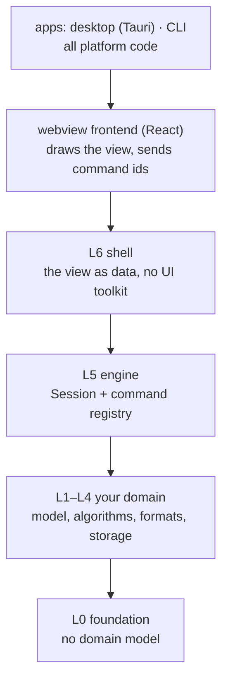

# Rust desktop architecture (Tauri + React webview)

The reference for how a Rust desktop app is built on this stack: a headless engine in which every
action is a command over immutable snapshots of a data model, a shell crate that turns the state
into a view as data, a thin React frontend in the platform webview that draws it, and all platform
code at the edge in the app binaries. Use it to answer "does this stack fit?", "where does this
code go?" and "is this change allowed by the rules?" quickly, then follow the link for depth. In
every file `myapp` stands for the project's machine name; "the template" is the starter project
that the `av-rust-desktop-bootstrap` skill scaffolds.

## When to use

- Choosing the stack, or checking the app is a fit for it.
- Placing new code in a layer, a new crate or the frontend; checking a dependency direction.
- Judging a proposed change against the rules (panics, logic in TypeScript, file system in the
  core, webview permissions, licences).
- Understanding a failing `cargo xtask layers`, `wasm` or `ci` step.
- Explaining how a click, a CLI call or an agent request reaches the model.

## Files

| File | Answers |
|---|---|
| [references/stack.md](references/stack.md) | Which language, shell, frontend, test and CI tools and versions; which crates per concern; when the stack fits; what the evidence labels mean |
| [references/principles.md](references/principles.md) | The nine rules, what enforces each, do and don't for the TypeScript frontend, webview security, and the conventions that follow |
| [references/layers.md](references/layers.md) | The layer diagram and table, where new code goes, what stays out of the core, how `cargo xtask layers` decides |
| [references/seams.md](references/seams.md) | The five interfaces (`execute`, `CommandSpec`, snapshots, `Services`, the view + control protocol), the webview boundary, one action end to end, frontends, threads |

## The stack in brief

| Concern | Choice |
|---|---|
| Language | A Rust core (edition 2024); TypeScript only in the webview frontend |
| Shell | Tauri 2: the window, the platform webview (WebView2, WKWebView, WebKitGTK), the bundler |
| Frontend | React 19 + TypeScript 7, built by Vite; tests with vitest; it draws a view and sends command ids |
| Structure | A Cargo workspace of small crates in enforced layers; the desktop app is the npm project `apps/myapp` with its Rust crate in `src-tauri` |
| Behaviour | Every user action is a command in a registry, run by id with JSON params |
| State | Immutable snapshots (`Arc`) of a serde data model; undo swaps pointers; UI state is one serde struct |
| Frontends | Desktop window, headless CLI, JSON control channel for agents: one engine |
| Quality gate | `cargo xtask ci`: fmt, web, clippy, layers, test, panic_hunt, doctest, wasm |

## The architecture in brief

- The **engine** has no UI toolkit in it and runs without a window. Everything a user can do is
  `Session::execute(id, params)`.
- The **shell** crate generates the view (UI state, document, menus) from the state and the
  registry; the **frontend** is thin: it draws that view and sends command ids. Its own state is
  what only the screen needs.
- **Apps** are small binaries that wire the two together and own everything platform-specific.
- A crate may depend only on lower layers. A tool checks this on every run of the gate.

## Where does new code go?

Ask in this order and stop at the first yes (full table in [references/layers.md](references/layers.md)):

1. Plain data the user's work consists of: **L1**.
2. A pure function over that data: **L2**, in a crate named for its domain.
3. Bytes in and out of your own format, or a store: **L3**.
4. Someone else's format or protocol: a **standalone L0** crate, plus an **L4** crate mapping it to your model.
5. Something a user does: a **command in L5** that calls the code above.
6. UI state, a menu or a shortcut: **data in L6, `crates/shell`**.
7. Something drawn or clicked: a **component in the frontend** (`apps/myapp/src`).
8. Only the platform can do it (dialog, socket, tray icon): **the app binary**, behind a `Services` hook.

## Routing

1. Fit question: read [references/stack.md](references/stack.md) ("When this stack fits" and "Know these properties").
2. Placement question: use the list above; for a new crate, register it in `xtask/src/layers.rs` (see [references/layers.md](references/layers.md)).
3. "Is this allowed?": check the rule table in [references/principles.md](references/principles.md); the rule and its enforcer tell you the fix.
4. "How does X reach the model?" or "what may the webview call?": [references/seams.md](references/seams.md).
5. Doing the change: load the `av-rust-desktop-develop` skill. Fitting a particular kind of app: the `av-rust-desktop-design` skill.

## Golden rules

These hold in every project built on this architecture. Each is enforced by tooling in the project.

1. **The core is Rust; the frontend is thin.** Web technology (React, TypeScript) lives only in the webview frontend, `apps/myapp/src`. It draws the view it is sent and sends command ids: no business logic, no document state, no file or network access in TypeScript.
2. **Never crash.** Non-test Rust code has no `unwrap`, `expect`, `panic!`, `unreachable!`, `todo!` or `unimplemented!`, and no `unsafe`. Return the crate's error type. Input is hostile: check bounds, cap sizes, bound recursion. A crash fix ships with a test that panicked before it.
3. **Everything is a command.** User-visible behaviour is a command in `crates/engine/src/*_cmds.rs` with an id, label, menu, shortcut, params doc, `enabled`, `run` and tests. The frontend, the CLI and the control channel dispatch ids.
4. **Layering is enforced.** A crate depends only on lower layers; nothing below the app binary uses tauri, wry or tao. `cargo xtask layers` checks it; register a new crate in `xtask/src/layers.rs`.
5. **UI state is data.** What automation should see is one serde struct in `crates/shell`, and the frontend draws exactly what `ui.inspect` returns. Colours come from the tokens in `tokens.css`. Look at a rendered image (`npm run snapshot`) before calling a UI change done.
6. **The webview gets the least it needs.** Two commands and one event; no plug-in permissions for the main window, a strict CSP, no remote content in it. What the webview sends is validated in Rust like any other input.
7. **The core builds for wasm32.** File-system code is `cfg(not(target_arch = "wasm32"))` or behind `Services`. `cargo xtask wasm` checks it.
8. **Tests are the gate.** Every change comes with tests. `cargo xtask ci` is the single definition of green, locally and in CI.
9. **Permissive licences only.** Crates, npm packages and bundled assets come from an allowlist (MIT, Apache-2.0, BSD, ISC, OFL-1.1, CC0-1.0, CC-BY-4.0 and similar); every bundled asset gets a row in `ATTRIBUTION.md`.

## Related skills

- `av-rust-desktop-bootstrap`: install the toolchain, scaffold the template, first build, Day-0 checklist.
- `av-rust-desktop-design`: fit a given kind of app into this architecture; replace the template's sample domain.
- `av-rust-desktop-develop`: add a command, query, crate, UI, shortcut or control method; fix a bug; review.
- `av-rust-desktop-grow`: background jobs, large data, canvas views, dialogs, preferences, autosave, formats, MCP, plug-ins.
- `av-rust-desktop-ship`: build profiles, the gate, CI, packaging and release, pre-release checklist.
