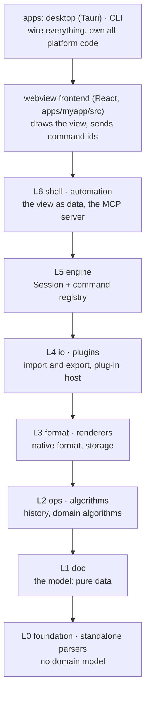

# Layers

The design in one sentence: a headless engine in which every action is a command over immutable
snapshots of a data model, a shell that turns the state into a view as data, a thin webview
frontend that draws it, and all platform code at the edge.

This file uses "the model" for whatever your user works on. In an editor it is a document; the
`av-rust-desktop-design` skill covers what it is in other kinds of app. Crate names such as
`myapp-doc` use `myapp` as a stand-in for the project's machine name.

## Layers



The CLI skips the frontend and the shell's view: it calls `Session::execute` directly.

| Layer | In the template | What belongs here | Typical additions as the app grows |
|---|---|---|---|
| L0 | none yet | Types with no domain model: geometry, units, colour, storage containers. Also standalone crates that parse or encode a foreign format and depend on no workspace crate, so they stay publishable on their own | `geom` `units` `color`; standalone parsers and codecs for foreign formats |
| L1 | `doc` | The model: plain serde data and the invariants that keep it valid | `doc` |
| L2 | `ops` | History, and domain algorithms written as pure functions over L0 and L1 data | `ops`; domain algorithm crates named for their domain |
| L3 | `format` | The native file format, storage, renderers | renderers, a `gpu` crate, storage; `format` |
| L4 | none yet | Mapping the model to and from foreign formats; a plug-in host | `io` `plugins` |
| L5 | `engine` | `Session` and the command registry: the façade every frontend talks to | `engine` |
| L6 | `shell` | The shell: UI state, the menu bar generated from the registry, parsed shortcuts, the control protocol, the view as data. It has no UI toolkit. An MCP server sits beside it | `shell`; `automation` (the MCP server) |
| testkit | `testkit` | Test helpers; other crates use it as a dev-dependency only | `testkit` |
| frontend | `apps/myapp/src` (not a crate) | React components, CSS tokens and the `Backend` wrapper: they draw the view and send ids | more components |
| apps | `myapp` (`apps/myapp/src-tauri`), `myapp-cli` (`apps/myapp-cli`) | Binaries: argument parsing, the window and webview, file dialogs, sockets, OS integration | the same two binaries |

The layer numbers have gaps on purpose: a crate added later slots in without renumbering. Two
crates in the same layer may not depend on each other unless the table says so explicitly (see
`INTRA_LAYER_ORDER` below).

## Where does new code go?

Ask in this order and stop at the first yes:

1. Is it plain data the user's work consists of? **L1.**
2. Is it a pure function over that data (compute, transform, validate, lay out)? **L2**, in a crate
   named for its domain.
3. Is it bytes in and out of your own format, or a store? **L3.**
4. Is it someone else's format or protocol? A **standalone L0** crate for the format itself, plus an
   **L4** crate that maps it to your model.
5. Is it something a user does? A **command in L5** that calls the code above.
6. Is it UI state, a menu or a shortcut? **Data in L6, `crates/shell`**: a field of `UiState`, an
   entry generated from the registry, a shell command.
7. Is it something drawn or clicked? A **component in the frontend** (`apps/myapp/src`).
8. Can only the platform do it (a dialog, a socket, a tray icon)? **The app binary**, behind a
   `Services` hook.

## What stays out of the core

The engine and everything below it, and the `shell` crate, contain:

- no tauri, wry, tao or other UI toolkit or webview types,
- no sockets, window handles or file dialogs,
- no `std::fs` outside `cfg(not(target_arch = "wasm32"))`,
- no global mutable state: a test creates as many `Session`s as it likes.

The layering check and the wasm gate enforce the first three.

## How `cargo xtask layers` decides

The rules are data in `xtask/src/layers.rs`. `check` reports violations over a small model built
from `cargo metadata` (so the rule engine has its own unit tests). Never edit the checker to make
a violation disappear; fix the dependency, or register the crate correctly.

### The table and its classes

- `PREFIX` is the package-name prefix of the workspace's crates (`myapp-`); the table uses short
  names without it.
- `TABLE: &[(&str, Class)]` assigns each crate a class. In the template:

  ```rust
  pub const TABLE: &[(&str, Class)] = &[
      ("doc", Class::Layer(1)),
      ("ops", Class::Layer(2)),
      ("format", Class::Layer(3)),
      ("engine", Class::Layer(5)),
      ("shell", Class::Layer(6)),
      ("testkit", Class::Testkit),
      // Apps and tooling.
      ("myapp", Class::Exempt),
      ("cli", Class::Exempt),
      ("xtask", Class::Exempt),
  ];
  ```

- `Class` has four variants:

  | Class | Meaning |
  |---|---|
  | `Layer(u8)` | A layered crate: it may depend only on crates in lower layers |
  | `Standalone` | Layer 0 and no workspace dependency at all (format parsers, codecs: publishable alone) |
  | `Testkit` | Test tooling: other crates may use it only as a dev-dependency |
  | `Exempt` | Binaries and build tooling: exempt from the rules. As a dependency target an app counts as above every layer, so nothing layered may depend on one |

- `INTRA_LAYER_ORDER: &[&[&str]]` lists explicit orderings within a layer: earlier may be used by
  later, e.g. `&["render", "gpu"]` when a GPU backend reuses the CPU reference. Empty in the
  template.
- `UI_CRATES: &[&str]` names the external crates that are a UI toolkit, a webview or a windowing
  dependency; a trailing `*` is a prefix:

  ```rust
  pub const UI_CRATES: &[&str] = &["tauri*", "wry", "tao", "muda", "webview2*", "webkit2gtk*", "winit", "rfd"];
  ```

  `wgpu` is deliberately not listed: a renderer below the UI layer may use the GPU, but no windows
  and no webviews.
- `UI_MIN_LAYER: u8 = 6` is the first layer allowed to use `UI_CRATES`. In the template only the
  app binary, which is exempt, actually depends on `tauri`.

A crate missing from `TABLE` is a violation, so a new crate cannot skip the check. Register every
new crate in `TABLE` in the change that adds it.

### The five violations

| Kind | Message |
|---|---|
| Unregistered | `<crate>: not in the layering table (xtask/src/layers.rs TABLE)` |
| Upward dependency (also a same-layer one not allowed by `INTRA_LAYER_ORDER`) | `<crate> (L<from>) depends on <dep> (L<to>): a crate may depend only on lower layers` |
| Standalone with a workspace dependency | `<crate> is standalone but depends on workspace crate <dep>` |
| Testkit as a normal dependency | `<crate> uses the testkit outside [dev-dependencies]` |
| UI crate below the UI layer | `<crate> (L<layer>) depends on UI crate <dep>: only L6 and above may` |

The command exits with `<n> layering violation(s)` after printing one line per violation, sorted
for stable output.

### Sample output

`cargo xtask layers` prints the table the gate checks. For the template's nine workspace packages
it should read:

```text
crate                layer          workspace deps
myapp                app/tooling    engine format shell
myapp-cli            app/tooling    engine
myapp-doc            L1
myapp-engine         L5             doc format ops testkit
myapp-format         L3             doc
myapp-ops            L2             doc
myapp-shell          L6             engine
myapp-testkit        testkit
xtask                app/tooling

layering: ok (9 crates)
```

The wasm gate (`cargo xtask wasm`) runs `cargo check --target wasm32-unknown-unknown` for every
`Layer` and `Standalone` crate in `TABLE`: in the template `doc ops format engine shell`. The app
binaries are not checked.
