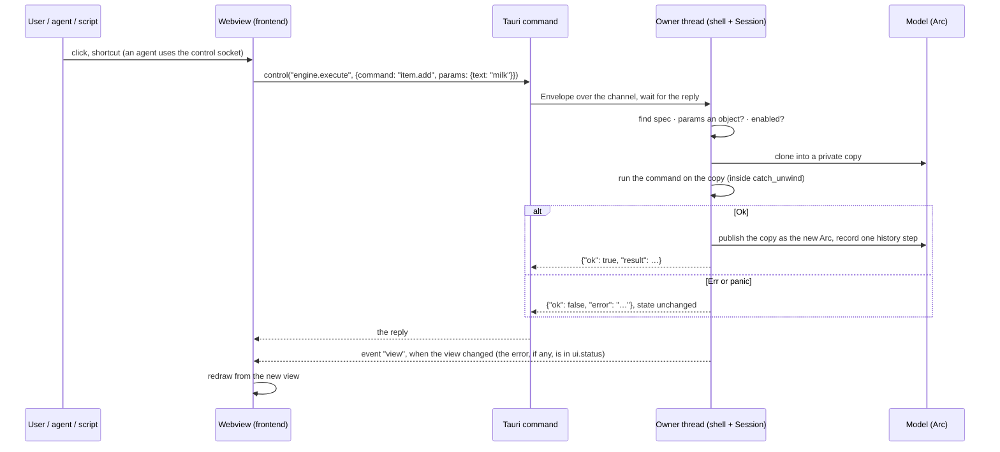

# The five seams

Everything else follows from five small interfaces. Each is a few dozen lines in the template and
keeps its shape as the app grows. Keep them small; never add a second way around one. In this file
`myapp` stands for the project's machine name, and all paths are inside the project.

## 1. `Session::execute(id, params) -> Result<Value>`

The only way anything happens. It:

1. looks the id up in the registry (unknown id is an error),
2. checks the params are a JSON object (`null` counts as an empty object),
3. checks the command's `enabled` predicate (the reason it returns is the error),
4. runs the command inside `catch_unwind`, so a panic becomes an error.

Params and results are JSON, so the same call works from a menu click, a shell script, a test and
an agent.

Implemented in `crates/engine/src/session.rs`.

`Session` API surface:

| Method | Does |
|---|---|
| `active()` | The open document's state (`Option<&DocState>`): snapshot, history, `revision`, `path` |
| `snapshot()` | The current model as `Option<Arc<Document>>`, cheap to take and safe to keep: later edits do not change it |
| `execute(id, params)` | As above |
| `edit(label, f)` | The undoable edit primitive (seam 3) |
| `undo()` / `redo()` | Swap to the previous or next snapshot; return the label of the step, or `None` at the end of history |
| `open_document(doc, path)` | Replace the open document (the template does not ask about unsaved changes) |
| `open_bytes(bytes, path)` | Decode bytes the caller obtained itself (a file dialog, a drop) and open them |
| `close_document()` | Drop the open document |

`EngineError` (in `crates/engine/src/error.rs`, via `thiserror`) is what `execute` returns:

| Variant | Message | When |
|---|---|---|
| `UnknownCommand(String)` | ``unknown command `{0}` `` | The id is not in the registry |
| `Disabled { id, reason }` | `` `{id}` is unavailable: {reason} `` | `enabled` returned a reason; this is what greys a menu item out |
| `BadParams(String)` | `bad params: {0}` | Params are not an object, or a field is missing or wrong |
| `Other(String)` | `{0}` | Anything else, including a caught panic and errors converted from lower crates |

A panic inside a command is logged and reported as an `Other` error saying the command failed with
an internal error and the document is unchanged.

## 2. The command registry

One `CommandSpec` per command:

```rust
pub struct CommandSpec {
    pub id: &'static str,              // "item.setDone": stable, dotted, camelCase
    pub label: &'static str,           // "Check Item"
    pub menu: &'static [&'static str], // ["Edit"]; empty = not in menus
    pub shortcut: Option<&'static str>, // "Cmd+Shift+Z"
    pub params: &'static str,          // what agents and scripts read
    pub enabled: Enabled,              // fn(&Session) -> Result<(), String>
    pub run: Run,                      // fn(&mut Session, &Value) -> Result<Value>
}
```

Specs are collected from `<area>_cmds.rs` modules that each export `specs()`. The menu bar
(`menus::model` in the shell), the shortcut table, `myapp-cli commands` and the control channel's
`engine.commands` are all generated from the registry. A command with a menu path gets its menu
item, shortcut and tooltip with no frontend code.

Implemented in `crates/engine/src/commands.rs`.

## 3. Immutable snapshots

The current state is an `Arc<Document>`. `Session::edit(label, f)`:

1. clones the model into a private copy,
2. lets the command change the copy,
3. only if the command returned `Ok`, publishes the copy as the new `Arc`, records one history step
   and bumps a revision counter.

Consequences:

- A failed or panicking command leaves the state untouched by construction. There is no rollback
  code.
- Undo and redo swap pointers. No command writes an "inverse".
- The shell, a background job or an autosave holds a snapshot for as long as it likes without a
  lock, and never sees a half-applied edit.
- The revision counter is a cheap cache key for anything derived from the state.

Cloning must be cheap for this to work: large payloads inside the model sit behind `Arc`, so a
clone copies pointers (the `av-rust-desktop-grow` skill covers the large-data pattern).

Revision and dirtiness live on `DocState`: `revision` (a `u64`) grows with every change, undo and
redo included, and is what any cache compares against. `dirty()` is true when the revision differs
from the revision at open or last save.

Implemented in `crates/engine/src/session.rs` and `crates/ops/src/lib.rs` (the history).

## 4. `Services`

A struct of optional function hooks that each app binary fills in: the template has a file picker
(`PickKind::Open` or `Save`, answering `None` when the user cancels), and a larger app adds the
clipboard, fonts, "open in browser", printing, notifications. The shell and the engine never call
the OS themselves.

Where a hook is missing (a headless test, a platform without it), the menu items that need it are
disabled with a reason, not broken: in the template, a missing file picker disables File > Open and
Save As with "file dialogs are not available here". This is what lets one shell run in the desktop
app and in headless tests.

Implemented in `crates/shell/src/services.rs` (the struct) and `apps/myapp/src-tauri/src/services.rs`
(the desktop's implementation, using `tauri-plugin-dialog`). The picker is called on the owner
thread, never on the main thread: the dialog plug-in's blocking calls wait for the main thread to
show the dialog.

## 5. The view and the control protocol

All shell state is one serde struct, `UiState { theme, hide_done, status }` (serialised camelCase:
`theme`, `hideDone`, `status`), in `crates/shell/src/state.rs`. `control::view(app)` returns one JSON
value, the view:

```text
{ ui, document, menus, shellCommands }
```

- `ui` is the `UiState`; `status` holds the last command's error and is empty after a success.
- `document` is what the `document.inspect` command returns, or `null` with no document open.
- `menus` is the menu bar generated from the registry: each item has `id`, `label`, `shortcut`
  (parsed), `enabled`, `reason` (why it is disabled: the tooltip) and `checked` (non-null for a
  shell-command toggle).
- `shellCommands` lists the shell commands with their `checked` state.

The view is what `ui.inspect` returns and it is everything the frontend draws: what a person sees
is what an agent reads. Four JSON methods expose the whole running app:

| Method | Does |
|---|---|
| `engine.execute {command, params?}` | Runs any command by id |
| `engine.commands` | Lists the registry with what is enabled now and why not |
| `ui.inspect` | Returns the view: the UI state, the document and the menus |
| `ui.set {theme?, hideDone?}` | Changes UI state; validates everything before changing anything, and an unknown field is an error that changes nothing |

The desktop app serves them on a loopback socket. Tests and the `view` example in `crates/shell`
call the same handler function directly, with no socket.

Implemented in `crates/shell/src/control.rs` and `apps/myapp/src-tauri/src/control_server.rs`.

### Shell side

- `AppShell::run(id, params)` tries shell commands (pure view state, such as the theme) first and
  then the engine. The outcome goes to the status bar (`ui.status`; empty after a success) as well
  as to the caller, so a failed command shows its error.
- `AppShell::answer(&Request)` answers one request from the frontend or from automation.
- `control::handle(app, method, params)` answers one control-protocol call. Every reply is
  `{"ok": true, "result": …}` or `{"ok": false, "error": "…"}`. `engine.execute` can run shell
  commands by id too. An unknown method is an error that lists the valid ones.
- `menus::invoke(app, id)` is what a menu click or a shortcut does: it collects what only the
  platform can ask for (a file dialog, through `Services`), then runs the command. Save on a
  document with no file yet behaves as Save As; a cancelled dialog runs nothing.
- Shortcuts are parsed in Rust (`crates/shell/src/shortcuts.rs`, `Shortcut { text, cmd, ctrl, shift,
  alt, key }`, from strings such as `Cmd+Shift+Z`), so a bad shortcut string fails a Rust test.

### Socket side (the desktop app)

The server is JSON lines: one request per line, one reply per line, each reply carrying the
request's `id`. Enable it with `--control <port>` (or `MYAPP_CONTROL_PORT`; port 0 picks any free
port) and optionally `--control-token-file <file>` (or `MYAPP_CONTROL_TOKEN_FILE`).

```text
{"id": 1, "method": "auth", "params": {"token": "<64 hex>"}}
{"id": 1, "ok": true, "result": {"authenticated": true}}
{"id": 2, "method": "engine.execute", "params": {"command": "item.add", "params": {"text": "milk"}}}
{"id": 2, "ok": true, "result": {"id": 1}}
```

Safety properties; keep every one when you extend the server:

- **Loopback only.** It binds `127.0.0.1`, never another interface, and binds before the window
  opens so a port in use is a startup error.
- **The first line must authenticate.** Nothing is dispatched before an `auth` request with the
  right token; a wrong token closes the connection.
- **Constant-time token comparison.** Every byte is compared, so the time taken does not say where
  two tokens differ.
- **Bounded request line.** At most 1 MiB (`MAX_REQUEST_BYTES = 1 << 20`); a longer line is an
  error, not an allocation.
- **Token file created owner-only.** The token is 64 hex characters; a missing file is created with
  a fresh token and mode 0600 on Unix (on Windows keep it in a private folder); an existing file
  that is not 64 hex characters is an error. Without a token file a fresh token is printed to
  standard error at launch.
- **60 s reply deadline** for the owner thread to answer a forwarded request.
- **Socket threads only parse and forward.** Each request crosses a channel to the owner thread,
  the same channel the webview's requests take.
- **`invoke_command` is not offered on the socket**, because it may open a native dialog.

## The webview boundary

Between the frontend and the app there are two Tauri commands and one event, and nothing else of
the app is reachable from the webview (rule 6 in [principles.md](principles.md)).

| Piece | Where | What it is |
|---|---|---|
| `control(method, params)` | `apps/myapp/src-tauri/src/commands.rs` | A control-protocol call: the same four methods automation uses (`engine.execute`, `engine.commands`, `ui.inspect`, `ui.set`) |
| `invoke_command(command)` | `apps/myapp/src-tauri/src/commands.rs` | A menu click or a shortcut: `menus::invoke` collects what only the platform can ask for, then runs the command |
| event `view` (`VIEW_EVENT`) | `apps/myapp/src-tauri/src/bridge.rs` | Carries the view to the webview whenever it changed |

Both commands do the same thing: wrap the call in a `Request` and ask the `Bridge`.

- `Request` (in `crates/shell/src/control.rs`) is `Control { method, params }` (what automation can
  send) or `Invoke { command }` (what only the frontend sends).
- `Envelope { request, reply }` is one request on its way to the owner thread, with the channel its
  reply goes back on; `Envelope::new(request)` also returns the receiver.
- `Bridge` (Tauri managed state, `bridge.rs`) holds the sender. `Bridge::ask` sends the envelope and
  waits for the reply off the async runtime's worker threads, with the 60 s deadline.
- The owner thread (`bridge::spawn_owner`) answers each envelope with `AppShell::answer`, then
  computes the view and compares it with the last one sent; if it differs it emits the `view`
  event. A change made through the control socket therefore reaches the window too.

`Backend` is the frontend's only way to the app (`apps/myapp/src/lib/types.ts`):

```ts
export interface Backend {
  /** A control-protocol call: `engine.execute`, `engine.commands`, `ui.inspect`, `ui.set`. */
  control(method: string, params?: Record<string, unknown>): Promise<Reply>;
  /** A menu click or a shortcut: the shell collects what the command needs, then runs it. */
  invoke(command: string): Promise<Reply>;
  /** Call `draw` whenever what should be on screen has changed. Resolves to "stop listening". */
  onView(draw: (view: View) => void): Promise<() => void>;
}
```

`Reply` is `{ ok: true; result } | { ok: false; error }`, the control reply shape. In
`src/lib/backend.ts`, `tauriBackend()` implements `Backend` with Tauri's `invoke` and `listen`, and
is the only place that imports `@tauri-apps/api`; `staticBackend(view)` draws a fixed view and
refuses every action (used by `npm run snapshot`); `connect()` picks one. Components receive a
`Backend` as a prop, so component tests pass a fake.

The app draws like this (`App.tsx`): subscribe with `onView`, then ask `ui.inspect` once for the
first view; the whole screen is a function of the one `view` value, and the root element's theme
attribute follows `view.ui.theme`.

Rules at the boundary:

- **UI state versus component-local state.** `UiState` holds what automation should be able to see
  and set (`theme`, `hideDone`, `status`). What a widget needs only while it is on screen (the text
  being typed, which menu is open) stays in the component. A value the user types or picks (the new
  item's text) travels as params of `engine.execute`.
- **Ask, then draw what comes back.** A checkbox is a controlled input: `checked` is the document's
  state and `onChange` only asks for the change, so the box changes when the new view arrives. A failed command's reason
  arrives as `ui.status` in the next view and is shown in the status bar.
- **Ids are `u64` in Rust and JSON numbers in the webview**, exact only below 2^53; a larger id is
  an error, not a crash.
- **Keep the view small.** It is serialised in full on every change.
- **Keep types in step.** `src/lib/types.ts` mirrors `control::view` and `document.inspect`; the
  frontend never builds these values itself.

## One action, end to end



The CLI is the same diagram without the webview and the Tauri command: it calls
`Session::execute` directly. A menu click or a shortcut uses `invoke_command(command)` in place of
`control(...)`, and the owner thread runs `menus::invoke`.

## Frontends

| Frontend | Crate | Talks to the engine through |
|---|---|---|
| Desktop window | `apps/myapp` (`src-tauri`) + the Tauri webview frontend in `apps/myapp/src` | `Backend` → the two Tauri commands → `AppShell::answer` → `Session::execute` |
| Headless CLI | `apps/myapp-cli` | `Session::execute` |
| Agents and scripts | Control socket in `apps/myapp` | `control_server` → the owner thread → `control::handle` → `AppShell::run` |
| Tests | Shell tests (`crates/shell/src/tests.rs`), component tests (`apps/myapp/src/**/*.test.{ts,tsx}`, fake backend), or `Session` directly | The same entry points |

## Threads

- **One owner thread owns the `AppShell` and so the `Session`.** Commands run there. It is started
  by `bridge::spawn_owner`, opens the document given on the command line (or a new one), and
  answers requests until every sender is gone.
- **Tauri commands and control-socket threads only forward.** The Tauri commands are async and run
  off the main thread; both they and the socket threads send `Envelope`s over one
  `std::sync::mpsc` channel and wait for the reply (60 s deadline). Automation therefore never
  races the user.
- **There are no frames and no repaint requests.** After each request the owner compares the view
  with the last one sent and emits the `view` event if it differs.
- **A blocking file dialog runs on the owner thread**, never on the main thread, so other requests
  wait while it is open.
- **Slow work becomes a background job**: a worker computes from a snapshot and hands back a result
  that the owner thread applies as one edit (the `av-rust-desktop-grow` skill covers background
  jobs with progress and cancel).
- **Data-parallel work inside an algorithm** uses rayon, on native targets only.
